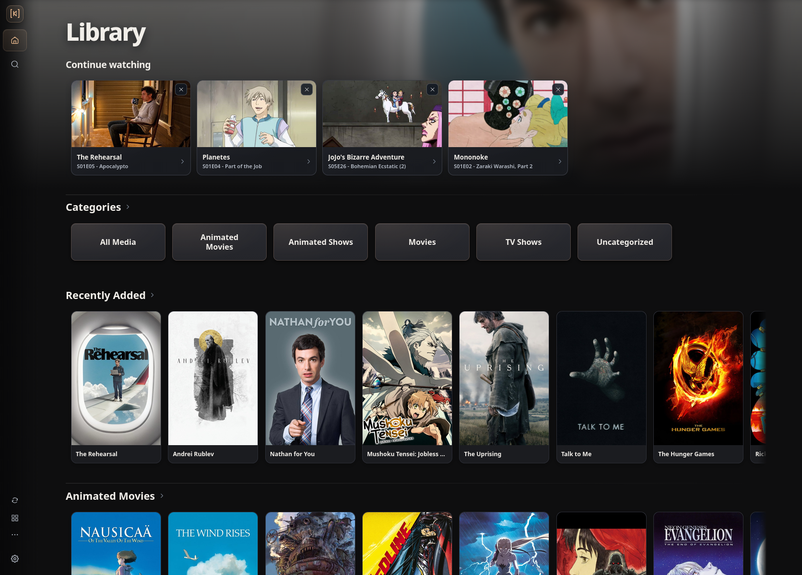
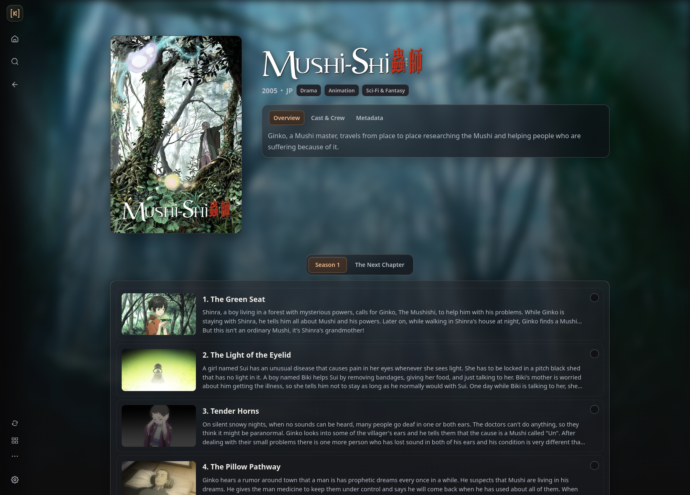
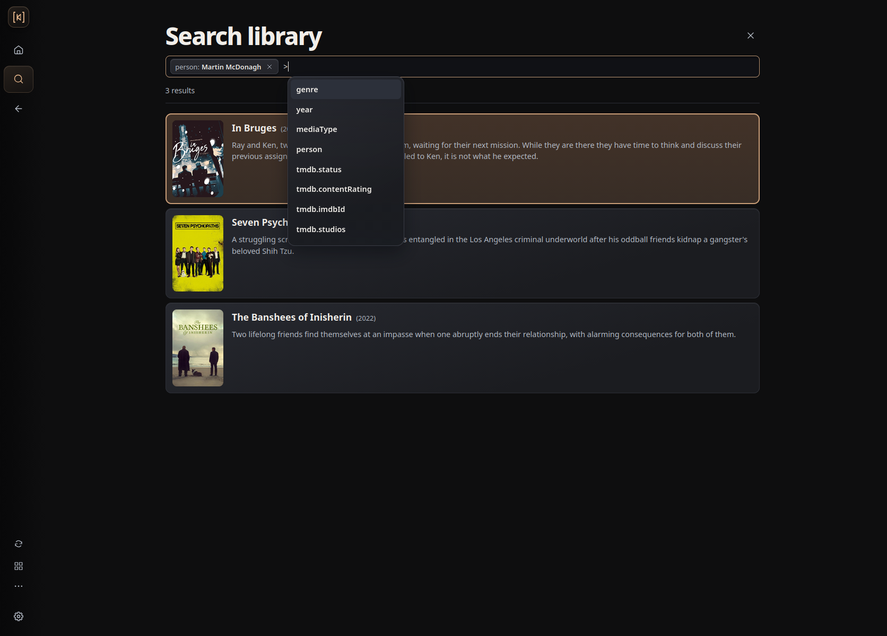
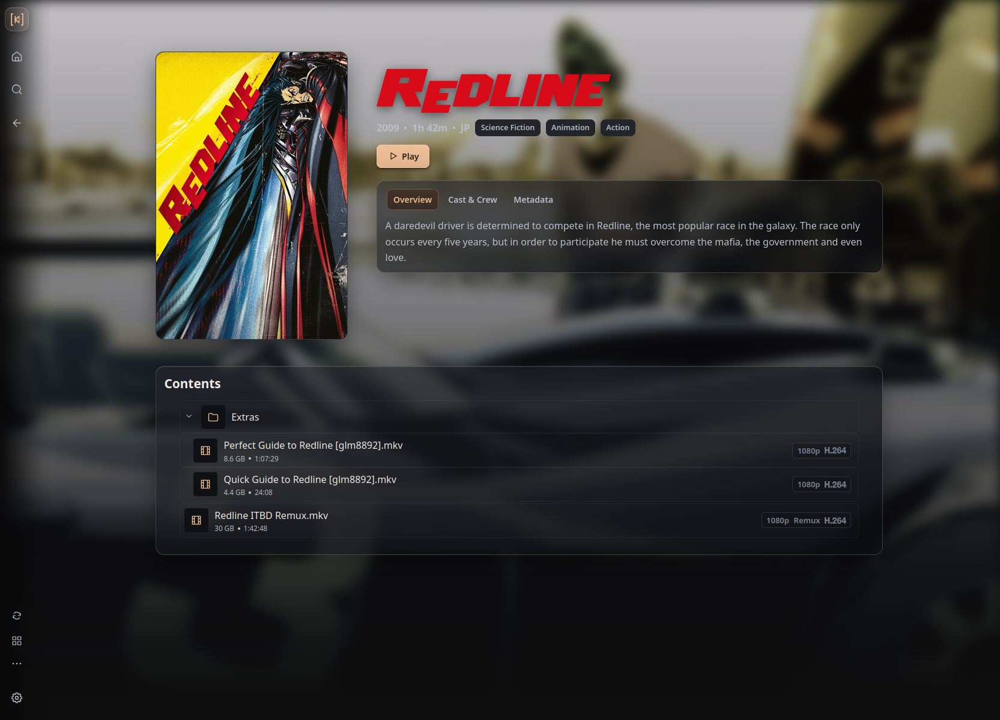

<!-- Maintainers: Keep this README mostly as-is. Edit it to correct inaccuracies; don't add detailed setup or feature documentation or implementation details. -->

# Kinome

Media server and manager. Fetches metadata from TMDB and displays it nice, streams media. Kinome works very differently from Jellyfin, but it speaks Jellyfin's API, so your Jellyfin apps, TV apps, and *arrs can (mostly) keep using it. Under development!







## Why use this?

Kinome already includes many features you'd expect, like multi-user support, a transcoding/transmuxing engine, web player, and so on. Here are the features which might be unique to Kinome:

- A clean and minimalist UI. 
- Does not force you into a specific folder structure. You can put your media into a single dir with mixed shows and movies, or organize into subdirs.
- An advanced virtual/dynamic tag system that can be used for searching, home screen organization, or blacklisting/whitelisting certain media for specific users. (Inspired by the best music player ever, MusicBee). 
  - For example, you can easily set a whitelist for PG-rated media only or for a custom tag.
- A good search bar which can search by text, (virtual) tags, and metadata like resolution.
- Easy custom player support. The webui can directly open files in MPV, VLC, or any other player you want after installing a local handler.
- Manual assignment flows for movies/shows/seasons. E.g., when a season folder is misclassified due to non-standard naming, simply right click, search for seasons and select the correct one. 
- Kinome has a different approach for the library structure. Think of it as a smart file browser. 
    - If you have your own deliberate folder structure, it will be be represented closely in the UI.
    - For example, tv show folders can include movies (e.g., because the movie is usually watched after the series, or because you are too lazy to reorganize that torrent). Just navigate into the tv show, right click the movie, then run a search for it to fetch metadata.
- A highly customizable home screen that allows you to group, sort and display media exactly how you want. In fact, every single folder can be customized like that!
  - The default home layout seen in the demo above is constructed using a grouping rule and virtual tags, which are fully configurable! For example, "Animated Movies" is defined as the rule `media type = movie AND genre contains Animation`.
  - You can create "virtual" folders, which can be manual, or automatically populated based on rules. Like a more advanced playlist or auto playlist. 

## Why not use this?

Kinome is under development and is probably not yet robust enough to replace your existing stack. If you're already running Jellyfin/Plex/Emby, I would run it side-by-side at least initially. 

It is also missing some features which one might expect to find in a media server. These are planned, but not yet available in the latest version:

- Automatic library rescans
- Automatic intro skipping
- Chromecast support
- Very messy media folders might not be shown as well as in other media servers (still, many common cases are handled). This is partly because Kinome wants to give you more freedom in how you organize and represent your library. 
- Pagination in the UI (very large libraries might be a bit slower to load)

See [**Plan.md**](./docs/Plan.md) for more details.

**In short**: If you are ~~autistic~~ particular about playback and organizing your media, try it! If you don't care about custom playback or library structure much, or you need higher reliability, keep your Jellyfin instance running at least side-by-side.

## Project Setup

This project uses [Bun](https://bun.sh/) for package management, bundling, and the runtime. Install dependencies:
```bash
bun install
```

### Development

Starts both the backend (Elysia) and frontend (Vite) in watch mode.
```bash
bun run dev
```

### Production Run

Builds the frontend and starts the backend server in production mode.
```bash
bun run prod
```

### Publishing & Packaging

#### Linux

Generate binaries and packages (Debian/RedHat) using `nfpm`.
```bash
# For x64 (Intel/AMD)
bun run publish:linux-x64

# For ARM64 (Raspberry Pi 4/5, etc.)
bun run publish:linux-arm
```

#### Windows

Generate a standalone executable and zip archive.
```bash
bun run publish:win
```
